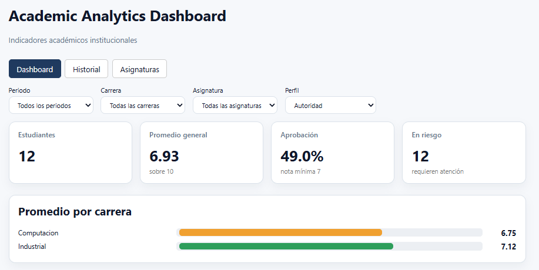
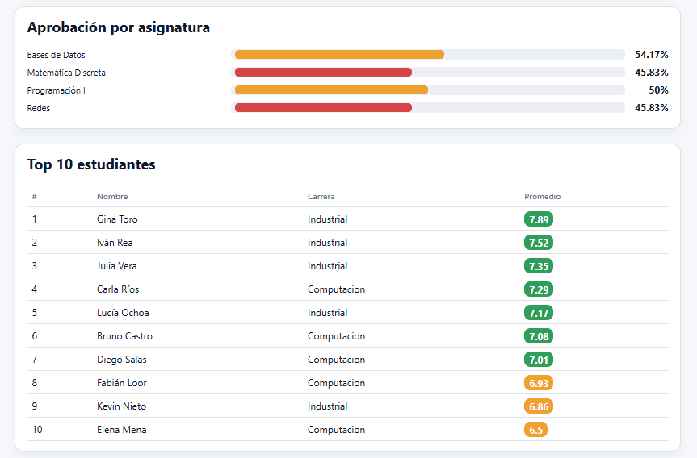
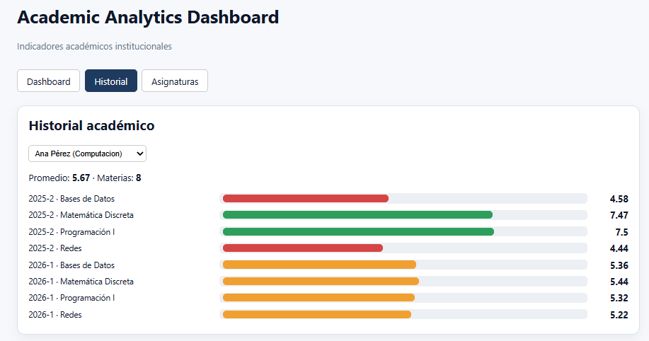
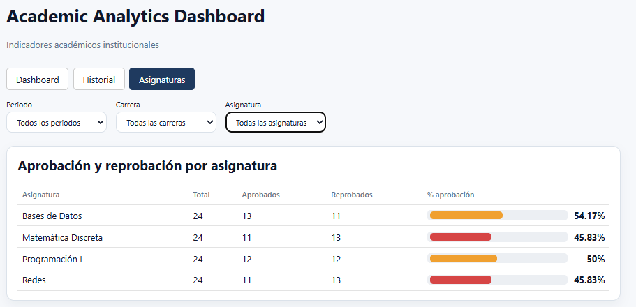
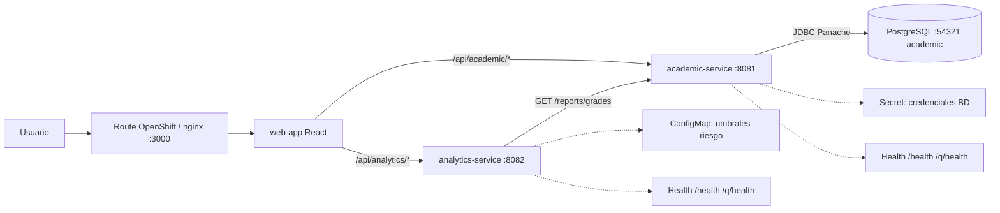

# Plataforma de Análisis Académico Institucional




**Solución distribuida basada en microservicios que permite **registrar información académica**, **calcular indicadores institucionales** y **visualizarlos en un dashboard web responsive**, desplegada en **OpenShift**.**

## Funcionalidades

- **Gestión académica** (`academic-service`): carreras, estudiantes, asignaturas, periodos académicos, calificaciones e historial académico por estudiante.
- **Indicadores institucionales** (`analytics-service`):
  1. Promedio general por carrera
  2. Porcentaje de aprobación/reprobación por asignatura (y por carrera + asignatura)
  3. Top 10 estudiantes con mejor promedio
  4. Estudiantes en riesgo académico (promedio < umbral o ≥ N asignaturas reprobadas)
- **Dashboard web** (`web-app`): vista institucional con tarjetas y tablas, historial por estudiante y reporte de aprobación por asignatura; filtros por periodo, carrera y asignatura; perfiles autoridad / coordinador / docente.

## Stack tecnológico

| Capa | Tecnología |
|---|---|
| Lenguaje | Java 25 |
| Build | Gradle 9.6 (Kotlin DSL, multiproyecto vía `settings.gradle.kts`) |
| Microservicios | Quarkus 3.40.1 — REST (Jackson), Hibernate ORM Panache, REST Client, Flyway, SmallRye OpenAPI, SmallRye Health |
| Utilidades | Lombok |
| Base de datos | PostgreSQL 17.7 (esquema y datos gestionados con Flyway) |
| Frontend | React + Vite (SPA), servido por nginx sin privilegios (`nginx-unprivileged`) |
| Contenedores | Docker / Docker Compose, imágenes en Docker Hub (`pablofernandosimbana/*`) |
| Nube | OpenShift (OpenShift Local / Developer Sandbox): Deployment, Service, Route, ConfigMap, Secret, PVC, probes |
| IDE | IntelliJ IDEA Ultimate + plugin Kubernetes (aplicar manifiestos, ver pods y logs) |

## Arquitectura

```
Usuario → Route (TLS edge) → web-app (React/nginx, 2 réplicas)
                               ├── /api/academic/*  → Service academic-service  (2 réplicas) → Service postgres (PVC)
                               └── /api/analytics/* → Service analytics-service (2 réplicas) → (REST) academic-service /reports/grades
```

- `academic-service` expone CRUD y un reporte plano basado en la vista SQL `v_grade_report`. Al arrancar, Flyway aplica `V1.0.1__schema.sql` y `V1.0.2__sample-data.sql`.
- `analytics-service` consume ese reporte por REST y calcula los indicadores en memoria con Streams (`groupingBy`, `averagingDouble`, `sorted`, `limit`, `filter`, `map`).
- Configuración del criterio de riesgo: `RISK_THRESHOLD` (por defecto `7.0`) y `RISK_MAX_FAILED` (por defecto `2`), inyectados desde el `ConfigMap`.

## Estructura del proyecto

```
gestion-insittucion/
├── academic-service/          # API REST académica (8081 local / 8080 en contenedor)
│   └── src/main/
│       ├── java/com/programacion/distribuida/academic/
│       │   ├── db/            # Entidades JPA (+ GradeReport sobre la vista)
│       │   ├── repo/          # Repositorios Panache
│       │   ├── rest/          # Recursos REST (+ InstanceRest)
│       │   └── dtos/
│       ├── docker/Dockerfile.jvm
│       └── resources/
│           ├── application.properties
│           └── db/migration/  # Flyway: V1.0.1__schema.sql, V1.0.2__sample-data.sql
├── analytics-service/         # API de indicadores (8082 local / 8080 en contenedor)
│   └── src/main/
│       ├── java/com/programacion/distribuida/analytics/
│       │   ├── clients/       # REST Client hacia academic-service
│       │   ├── service/       # IndicatorService (Streams)
│       │   ├── rest/          # AnalyticsRest
│       │   └── dtos/
│       ├── docker/Dockerfile.jvm
│       └── resources/application.properties
├── web-app/                   # React + Vite; nginx.conf y Dockerfile.jvm
├── deploy/                    # Manifiestos OpenShift
│   ├── 00-config.yaml             # Secret (credenciales BD) + ConfigMap (URLs, umbrales, puerto)
│   ├── 01-postgres.yaml           # PVC 1Gi + Deployment (Recreate) + Service
│   ├── 02-academic-service.yaml   # Deployment (2 réplicas) + Service + Route
│   ├── 03-analytics-service.yaml  # Deployment (2 réplicas) + Service + Route
│   └── 04-web-app.yaml            # Deployment (2 réplicas) + Service + Route pública
├── images/                    # Capturas del dashboard
├── docker-compose.yml
├── settings.gradle.kts
└── build.gradle.kts
```

## Endpoints principales

**academic-service** — `http://localhost:8081` (en OpenShift: `https://<route-academic>`)

| Método | Ruta | Descripción |
|---|---|---|
| GET/POST/PUT/DELETE | `/careers`, `/subjects`, `/periods`, `/students` | CRUD |
| GET | `/students/{id}/history` | Historial académico |
| POST | `/grades` | Registra/actualiza nota `{studentId, subjectId, periodId, score}` |
| GET | `/reports/grades` | Reporte plano (vista `v_grade_report`) |
| GET | `/health`, `/q/health`, `/instance`, `/q/swagger-ui` | Operación |

**analytics-service** — `http://localhost:8082/analytics` (en OpenShift: `https://<route-analytics>/analytics`; query params opcionales `period`, `career`, `subject`)

`/summary`, `/average-by-career`, `/approval-by-subject`, `/approval-by-career-subject`, `/top-students`, `/at-risk` · además `/health` y `/q/health`.

## Comandos

> Referencia de uso. Ejecutar desde la raíz del proyecto salvo que se indique otra carpeta.

### Base de datos local

```bash
docker run -d --name pg -e POSTGRES_USER=postgres -e POSTGRES_PASSWORD=postgres \
  -e POSTGRES_DB=academic -p 5432:5432 postgres:17.7
```

No hace falta cargar SQL a mano: Flyway (`quarkus.flyway.migrate-at-start=true`) crea el esquema y los datos de prueba al iniciar `academic-service`. Ajustar `quarkus.datasource.*` en `application.properties` a las credenciales locales.

### Desarrollo

```bash
./gradlew :academic-service:quarkusDev    # http://localhost:8081
./gradlew :analytics-service:quarkusDev   # http://localhost:8082
cd web-app && npm install && npm run dev  # http://localhost:5173 (proxy a ambos servicios)
```

### Build

```bash
./gradlew :academic-service:build :analytics-service:build   # genera build/quarkus-app
cd web-app && npm run build                                  # genera dist/
```

### Docker Compose (stack completo)

```bash
docker compose up -d
# web-app: http://localhost:3000 · academic: :8081 · analytics: :8082 · postgres: :54321
docker compose down
```

## Despliegue en OpenShift

### 1. Clúster

**OpenShift**

**Developer Sandbox** (https://developers.redhat.com/developer-sandbox) → *Copy login command* → `oc login ...` (el proyecto `<usuario>-dev` ya existe).

### 2. Imágenes

```bash
./gradlew :academic-service:build :analytics-service:build
docker build -f academic-service/src/main/docker/Dockerfile.jvm  -t pablofernandosimbana/academic-service:latest  academic-service
docker build -f analytics-service/src/main/docker/Dockerfile.jvm -t pablofernandosimbana/analytics-service:latest analytics-service
docker build -f web-app/Dockerfile.jvm -t pablofernandosimbana/web-app:latest web-app
docker login
docker push pablofernandosimbana/academic-service:latest
docker push pablofernandosimbana/analytics-service:latest
docker push pablofernandosimbana/web-app:latest
```

> `web-app` usa `nginxinc/nginx-unprivileged`: OpenShift ejecuta los contenedores con un UID aleatorio (SCC `restricted-v2`) y la imagen oficial de nginx no puede escribir en `/var/cache/nginx`.

### 4. Recursos desplegados

| Recurso | Nombre | Detalle |
|---|---|---|
| Secret | `postgres-credentials` | `POSTGRES_USER`, `POSTGRES_PASSWORD`, `POSTGRES_DB` (usado por Postgres y por academic) |
| ConfigMap | `gestion-config` | `QUARKUS_DATASOURCE_JDBC_URL`, `QUARKUS_REST_CLIENT_ACADEMIC_API_URL`, `RISK_THRESHOLD`, `RISK_MAX_FAILED`, `QUARKUS_HTTP_PORT` |
| PVC | `postgres-data` | 1Gi RWO, `PGDATA` en subdirectorio `pgdata` |
| Deployment | `postgres` (1), `academic-service` (2), `analytics-service` (2), `web-app` (2) | requests/limits de CPU y memoria |
| Service | `postgres:5432`, `academic-service:8080`, `analytics-service:8080`, `web-app:8080` | ClusterIP; nginx enruta por nombre de Service |
| Route | `web-app` (pública), `academic-service`, `analytics-service` | TLS edge con redirección HTTP→HTTPS |

### 5. Salud, observabilidad y escalabilidad

| Servicio | startupProbe | readinessProbe | livenessProbe |
|---|---|---|---|
| postgres | — | `pg_isready` | `pg_isready` |
| academic-service | `/q/health/started` | `/q/health/ready` (incluye datasource) | `/q/health/live` |
| analytics-service | `/q/health/started` | `/q/health/ready` | `/q/health/live` |
| web-app | — | `GET /` | `GET /` |